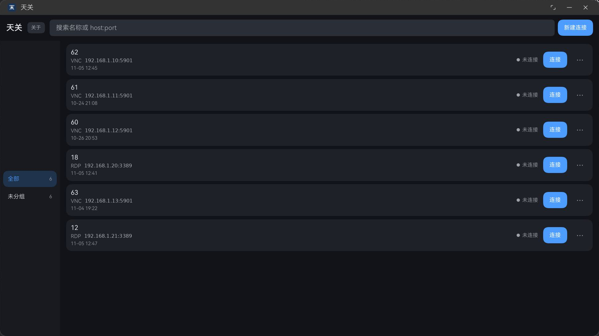
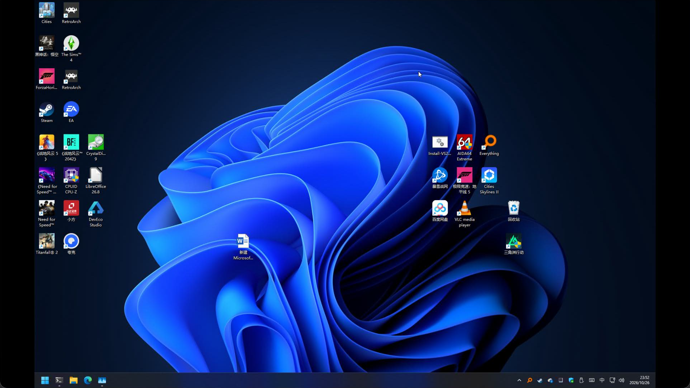
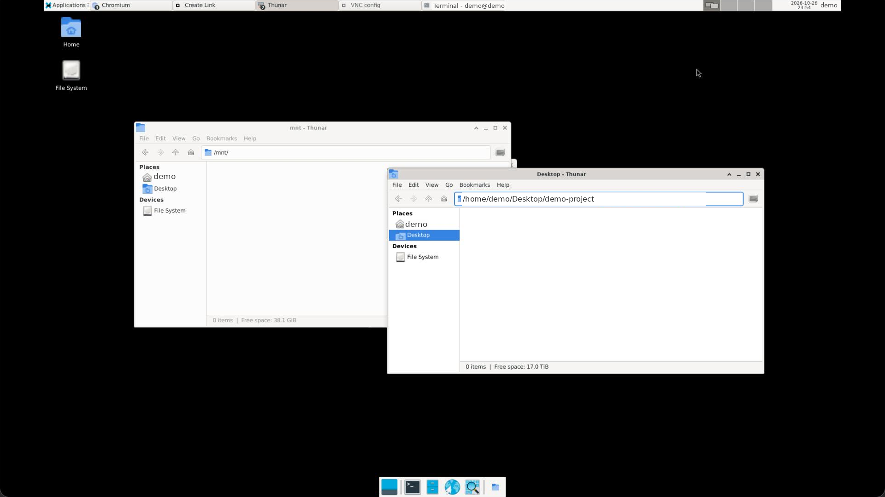

# 天关 / Tianguan（TG）

**HarmonyOS 上的原生 VNC / RDP 远程桌面客户端。**

GPL-3.0-or-later · 当前版本 1.0.0 · API 26+ · 包内支持手机 / 平板 / PC（2in1），首发上架仅 PC/2in1



天关把每个远程会话做成一个独立窗口，从 Dock 或系统窗口选择器直接切换，主窗口只负责连接管理。它连接运行 VNC 或 RDP 服务的主机，包括 Windows、Linux 与树莓派。

画面经原生 EGL/GLES 渲染，不经过 WebView。VNC 已在鸿蒙 PC 与手机验证，RDP 已在鸿蒙 PC 验证。1.0.0 尚未上架，也还没有预编译安装包。

Tianguan (TG) is a native VNC and RDP client for HarmonyOS. Its name comes from a star gate in the *Jin Shu* (Book of Jin). The first release targets PC and 2-in-1 devices only; it is an independent community project, not affiliated with or endorsed by Huawei.

## 功能

连接以卡片列表呈现，保存过的主机按分组排列，可按名称或 `host:port` 搜索。每张卡片单独记录协议与端口，VNC 与 RDP 分开保存。密码存入系统密钥库，不写入配置文件。

每个会话对应一个独立窗口，拥有自己的 socket、线程、帧缓冲与剪贴板；关闭窗口即结束会话。2in1 上主窗口可驻留系统托盘，Dock 与系统窗口选择器各有一张卡片。

RDP 走 GFX 图形管线与 H.264/AVC 解码，VNC 解码原始像素，两者共用同一条原生 EGL/GLES 渲染路径，画面经 XComponent(SURFACE) 直出。两种协议都支持双指缩放与平移。

RDP 经 rdpsnd 输出 PCM 音频，实测 44.1 kHz 立体声；VNC 协议不包含音频通道，VNC 会话没有声音。剪贴板双向同步纯文本，单次上限 1 MiB，`\r\n` 归一为 `\n`；本机 → 远端需 `READ_PASTEBOARD` 授权。

窗口宽度低于 600 vp 时（手机与较窄的 2in1 窗口）采用单列布局，旋转后重新排列，支持双指缩放。长按约 0.5 秒映射为右键，返回即断开会话。





## 设计取舍

做天关的直接原因是 HarmonyOS 上缺少可直接使用的原生远程桌面客户端。取舍集中在渲染、会话、身份校验、输入与项目边界五处。

- 原生渲染而非 WebView：画面经 XComponent(SURFACE) + EGL/GLES 直出，避免每帧拷贝与额外一层 JS 桥。
- 一个会话一个 UIAbility（`launchType: "multiton"`）：窗口即会话，关窗即断开，避免窗口关闭后连接仍留在后台的状态。
- 身份校验用 TOFU 指纹而不是证书链：VNC 侧上游只提供 64 位截断指纹，RDP 侧为 SHA-256。
- 中文输入交给远端输入法：客户端不实现 IME 组合输入，只按物理按键转发，映射表之外的 Unicode 无法直接输入。
- 上游不 vendor：TigerVNC 与 FreeRDP 按固定版本由脚本获取并交叉编译，仓库只保留脚本。

## 名字：天关

天关是《晋书·卷十一·天文志上》记载的一颗星，原文为「天关一星，在五车南，亦曰天门，日月之所行也，主边事，主关闭。」原文见 [维基文库](https://zh.wikisource.org/zh-hans/晉書/卷011)。它在五车之南，又名天门；「日月之所行」指日月运行经过此处，「主边事，主关闭」指其掌管边关与门户启闭。

远程桌面的语义与此接近：跨过网络进入另一台机器，连接与断开对应门的开合。这条联系是产品层面的引申，古义以上面的引文为准。

命名沿用一套星官体例：项目所有者另一套以星官命名的项目「太一」先用了「柱史」「阁道」等名字，天关是这套体例里选出的下一个星官名。选名约束是可查古籍原文、能配合太一体系、不与已有名字重复、英文用拼音。

英文名 Tianguan，简称 TG；仓库 [alfadb/tianguan](https://github.com/alfadb/tianguan)，包名 `cn.alfadb.tianguan`。曾用名「鸿桌 / HongDesk（HD）」已不再使用；中科院的爱因斯坦探针卫星也叫「天关」，两者只是同名。天关是独立社区项目，非华为官方，与华为没有隶属或背书关系。

## 当前状态

1.0.0 已覆盖安装到 PC 与手机（`install -r`，连接与密钥库保留）；PC 上 VNC 与 RDP、手机上 VNC 各一条连接均已复测连通。尚未上架、未提交审核，发布证书与 Profile、APP 备案尚未办理；首发仅 PC/2in1 时不申请软著，以后加入手机再办。版本变更见 [CHANGELOG.md](CHANGELOG.md)。

已验证：

- VNC 连接真实服务端，完成 RA2_256 认证、画面与键鼠交互；RA2 与 VncAuth 的协商在 PC 上覆盖过。
- RDP 连接 Windows，完成 NLA 登录，画面、键鼠、剪贴板（双向，含手机端）、音频与 GFX + H.264/AVC 均实测通过。
- 多会话、多窗口、Dock 窗口选择器与 2in1 系统托盘可用；关窗即断开会话。
- GL 呈现连续采样 3 分钟，显存平稳，无 GPU 错误。
- 滚轮经 `onAxisEvent` 转发为 RFB 按钮 4 / 5，PC 真机实测滚动正常。

未实现：

- VNC 的 X509Vnc：客户端没有 VeNCrypt/TLS 通道，依赖构建未启用 GnuTLS；服务端身份目前只做指纹 TOFU。
- RDP 的磁盘、打印机、智能卡、摄像头与多显示器重定向：通道未接入，当前只有画面、键鼠、剪贴板与音频。

未验证：

- RDP 服务端指纹变化后的拒绝路径：只有代码审查；构造该场景要更换或伪造服务端证书，尚未在真机复现。

构建通过不等于功能通过：已验证、未实现与未验证分开记录。逐项证据见[应用说明](app/README.md)的「验证边界」，VNC 内核实验的复现步骤见 [VNC 实验说明](experiments/vnc-core/README.md)。

## 边界

- 非华为官方项目，与华为没有隶属、背书或合作关系。
- 不是远程桌面服务端：目标主机需自行运行 VNC 或 RDP 服务。
- 包内只有手机、平板与 PC（2in1），不含智慧屏；首发上架仅 PC/2in1。
- 不支持 H.265/HEVC：RDP 的 GFX 协议只定义 AVC，没有该编码。

## 构建

仓库不提供预编译安装包，需要自行构建。

```bash
bash app/build.sh                  # 未签名 HAP
bash scripts/test.sh               # 原生 CTest + ArkTS 单测，不需要设备
bash scripts/build-release.sh      # 未签名 .app
```
原生库先由 `scripts/fetch-tigervnc.sh`、`scripts/build-vnc-deps.sh ohos`、`scripts/build-rdp-deps.sh ohos` 准备到 `.work/`，上游源码不入库。脚本内固定了本机命令行工具路径，换机器时需要修改。签名与上架流程见[发布构建与签名方案](docs/release-pipeline.md)。

## 许可与贡献

天关自有代码采用 GPL-3.0-or-later：LICENSE 为 GPLv3 官方原文，「or later」由 README 与[许可说明](docs/licensing.md)明确。上游 TigerVNC、FreeRDP 与 FFmpeg 各按自己的许可分发，源码不 vendor 进仓库。参与不要求签署 CLA，方式见 [CONTRIBUTING.md](CONTRIBUTING.md)；源码在 https://github.com/alfadb/tianguan 。上架用的最终用户协议见 [docs/store/eula.md](docs/store/eula.md)：它与 GPL 兼容，不改变 GPL 授予的权利。
